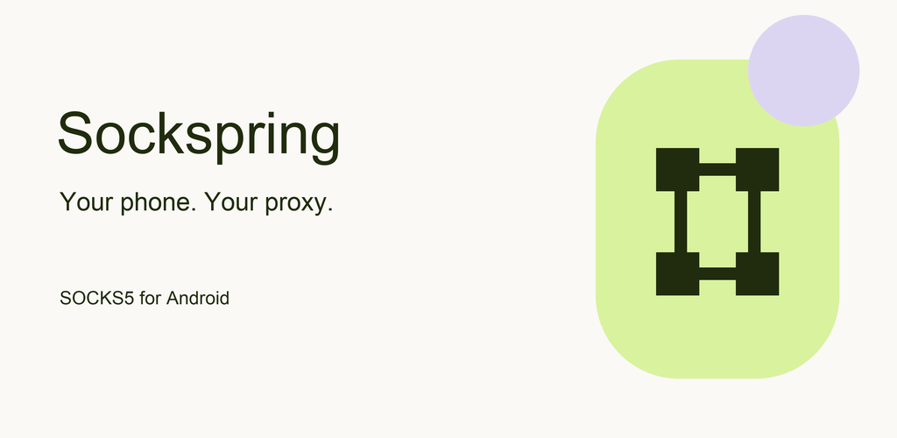
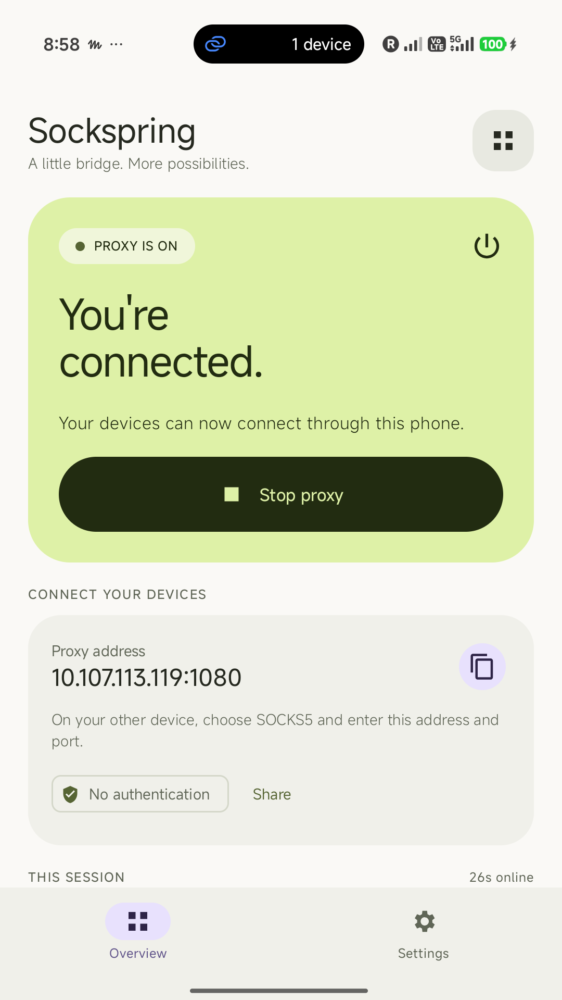
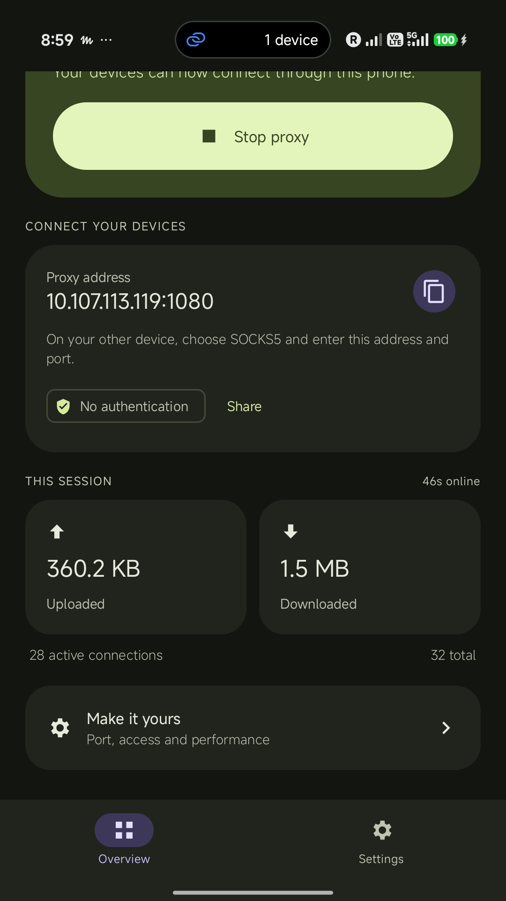
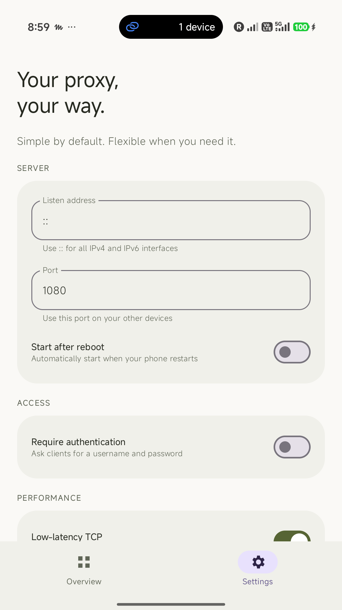

<p align="center">
  
</p>

<h1 align="center">Sockspring</h1>

<p align="center">
  A SOCKS5 proxy server for Android.<br>
  Built with Material 3 Expressive and a native Rust engine.
</p>

<p align="center">
  <a href="#getting-started">Getting started</a> ·
  <a href="docs/development.md">Build from source</a> ·
  <a href="PRIVACY.md">Privacy</a> ·
  <a href="https://github.com/shyim/sockspring/issues">Report an issue</a>
</p>

---

Sockspring turns your Android device into a proxy for your other devices. Start the server, copy its address, and connect a SOCKS5-compatible client. A clear dashboard keeps connections and traffic visible, with a Stop action always available in the app and its ongoing notification.

**Android 7.0+ · No ads · No analytics · No app account · MIT licensed**

## Why Sockspring?

Sockspring is my escape hatch when traveling. I want reliable internet for my laptop and other devices without hunting for Wi-Fi. An unlimited travel eSIM can cover my phone, while hotspot limits make sharing that connection harder.

I built Sockspring to give my other devices another way to use that connection: a SOCKS5 proxy running on my phone. It is a small, practical tool for working around hotspot limitations with compatible clients. Your devices still need a network connection to the phone, and what works depends on the eSIM plan and carrier.

## A closer look

<p align="center">
  
  &nbsp;
  
  &nbsp;
  
</p>

<p align="center"><sub>Actual app screenshots: overview, live traffic, and settings.</sub></p>

## Features

| Everyday controls | Flexible networking |
| --- | --- |
| One-tap start and stop | SOCKS5 TCP and UDP support |
| Copy or share your proxy address | IPv4, IPv6, and hostname resolution |
| Live traffic, connections, and session uptime | Optional username/password authentication |
| Light and dark themes | Configurable listening address and port |
| Ongoing notification with a Stop action | Low-latency TCP option using TCP_NODELAY |
| Optional startup after reboot | Advanced source binding, workers, and UDP-over-TCP support |

## Getting started

Sockspring is being prepared for Google Play and is **not yet listed there**. You can [build an APK from source](docs/development.md#build).

1. Open Sockspring on your Android device.
2. Tap **Start proxy** and allow the requested permissions. Android 17 and newer require local-network access.
3. On another device that can reach your phone, configure a SOCKS5-compatible client with the address shown in **Overview**. The default port is `1080`.
4. Use **Stop proxy** in the app or **Stop** in its notification when you are finished.

For example, from a computer on the same reachable network:

```sh
curl --socks5-hostname PHONE_ADDRESS:1080 https://example.com/
```

Replace `PHONE_ADDRESS` with the address shown in the app. Wi-Fi client isolation, hotspot settings, and network restrictions can prevent devices from reaching each other.

To change the port, enable authentication, or adjust advanced networking options, stop the proxy and open **Settings**.

## Privacy and security

Settings stay in app-private storage, and Android backup is disabled. Sockspring has no advertising, analytics, or publisher-operated proxy backend. Network requests go to the destinations your clients choose. Read the full [privacy policy](PRIVACY.md) for details.

**SOCKS5 does not encrypt traffic or proxy passwords.** Use a trusted network and enable authentication when appropriate. HTTPS and other end-to-end encrypted connections retain their own encryption through the proxy.

Sockspring is a proxy server, not a VPN service. It does not provide remote proxy servers or automatically route all traffic from your devices.

## Development

The Android interface is written in Kotlin with Jetpack Compose. A Rust/Tokio engine handles proxy traffic; JNI is used only for lifecycle control and statistics.

- [Development guide](docs/development.md) — toolchain, builds, tests, architecture, and benchmarking.
- [Play release kit](distribution/play/README.md) — signing, store assets, and submission instructions.

Package name: `de.shyim.sockspring`.

Contributions are welcome. For a bug report, include the app version, Android version, reproduction steps, and expected behavior. Keep passwords and sensitive network data out of reports.

## Support

Open an [issue on GitHub](https://github.com/shyim/sockspring/issues) or email [socksspring@shyim.de](mailto:socksspring@shyim.de).

Published by **Shyim**.

## License

Released under the [MIT License](LICENSE).
